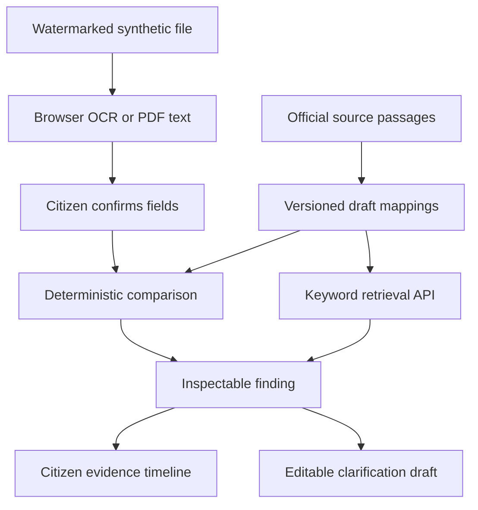

# Architecture

The recommended multi-service FastAPI/PostgreSQL stack was reduced to a deployable Cloudflare Worker and a browser-local synthetic case workspace. Next-compatible React and TypeScript run on Vinext, retaining the Sites build integration. This avoids an unavailable managed Python backend and persistent sensitive identity store.

## Components
- `components/civic/app.tsx`: citizen views, session state, local upload handling, confirmation, exports.
- `lib/civic/engine.mjs`: source registry, clause mappings, normalization, extraction, conditions, keyword scoring, conservative abstention, bilingual letter templates.
- `app/api/evidence/route.ts`: GET registry, POST request evaluation or conditional evaluation. Request text max 2,000 characters; JSON body max 12,000 characters.
- `public/reports`: generated benchmark, submission docs, screenshots, source archive.
- `migrations/001_proposed_schema.sql`: validated future schema. Not deployed.

## Runtime model
Tesseract.js 5.1.1 with eng+ben OCR; PDF.js 4.10.38 for PDF parsing. These are pinned external CDN imports and need network access. LLMs, embedding models, MCP tools, Graph RAG, vector DB, fine-tuning, and autonomous agents are not runtime dependencies.

## Data boundaries
File bytes and raw OCR remain browser-local. The checker sends fictional request text and conditions to the same-origin Worker. No case records are written on the server. Platform identity controls private Site access; no separate user case-account system exists. UI state uses sessionStorage; only language preference persists via localStorage.

## Traceability
Source ID → source version → passage / clause → draft rule version → user-reported context or confirmed field → status → explanation → user-controlled action. The specialist-review stage is pending and remains visibly labeled. Case documents are not authenticated government records.
